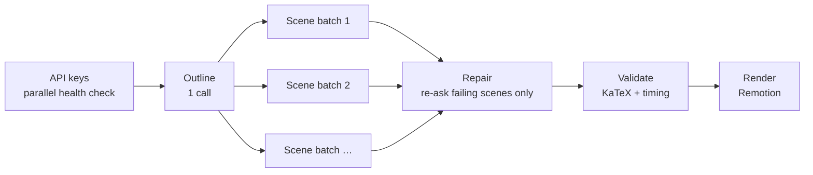

# ScriptMotion

ScriptMotion turns a school topic and a short teacher's brief into an animated lesson video (1080p MP4). It is built for NCERT/CBSE Classes 8–12 physics, chemistry and maths.

Language models never write code or draw anything. A model picks components from a library of 54 pre-built animations and fills in their data, for example "convex lens, f = 10 cm, object at 30 cm". The components compute the physics, geometry and layout themselves. That keeps every video accurate and gives the same visual quality whichever model writes it.

## Quick start

Add NVIDIA API keys to `.env`. One key works; more keys run in parallel and fail over to each other:

```
NVIDIA_API_KEY_1=nvapi-...
NVIDIA_API_KEY_2=nvapi-...
```

Then start everything with one command:

```bash
python start_server.py
```

It installs any missing Python packages and the Remotion renderer on first run, checks the keys,
starts the studio on http://localhost:8000 and opens it in your browser (`--port 8080`, `--no-browser`).

Or run from the command line:

```bash
python main.py "Image formation by a convex lens" \
  --brief "Class 10. Use f = 10 cm. Show the object beyond 2F, then between F and O. End with one numerical." \
  --duration 90
```

| Flag | Meaning |
|---|---|
| `--brief` | What the video must do: focus, values, examples, what to skip. Each scene's setup comes from here. |
| `--duration` | Target length in seconds (30–300). |
| `--audience` | For example `"Class 12 student"`. |
| `--model` | `nemotron-ultra` (default), `kimi`, `nemotron-lightning`. |
| `--no-render` | Plan and validate only. |

Each run writes `output/videos/<time>-<topic>/` containing `lesson.mp4`, `storyboard.json`, `outline.json`, `run.json`, and `trace/`. The trace holds every prompt and response, for debugging.

## Pipeline



1. **Keys.** All keys are pinged in parallel. Rejected keys are skipped. Rate-limited keys cool down while the other keys continue (`src/llm/keypool.py`).
2. **Outline.** One call sees a one-line menu of components and returns the scene plan. Each scene gets a concrete goal (`src/planner.py`).
3. **Scenes.** Scenes are written in batches of up to 3, in parallel across healthy keys. Each batch prompt contains only the schemas for its own component types, which keeps token use low.
4. **Repair.** Every scene is validated against its schema (`src/schema.py`, `src/catalog.py`) and sanity-checked (`src/storyboard.py`). Checks include unbalanced reactions, bad function expressions, objects placed at the focus, and copied example values. Only failing scenes are re-asked, each with its exact error. A scene that still fails becomes a text scene.
5. **Validate.** Every formula is compiled with the same KaTeX build the video uses. Scene durations are derived from content and fitted to the target length.
6. **Render.** `remotion_project/scripts/render-video.mjs` renders the storyboard and reports progress as JSON.

`main.py` emits structured events (`SM_EVENTS=1`). `app.py` streams them to the studio over Server-Sent Events, where they drive the pipeline graph, the key panel and the log.

## Component library

All components live in `remotion_project/src/lesson/scenes/`. They are registered in `registry.tsx` and described to the model in `src/catalog.py`.

| Subject | Components |
|---|---|
| Physics (22) | lens, mirror, refraction (with TIR sweep), prism (dispersion), interference, em_wave, wave, field_lines (with equipotentials), magnetic_field, circuit, induction, ac_phasor, projectile, motion_graph, free_body, circular_motion, orbit, pendulum, spring_mass, gas_particles, pv_diagram, energy_levels |
| Chemistry (8) | atom, periodic_table, bonding, vsepr, reaction (atom-balance check), ph_scale, electrochemical_cell, hydrocarbon |
| Maths (12) | function_graph, number_line, unit_circle, right_triangle, geometry, solid, matrix_transform, matrix_multiply, vectors, venn, dice_grid, sequence |
| General (12) | title, key_points, definition, equation, worked_example, compare, process, cycle, table, chart, quiz, recap |

Check every component visually. This command renders 3 stills of each fixture from one bundle, in parallel, and writes a contact sheet to `output/component-check/index.html`:

```bash
python check_components.py            # all components
python check_components.py lens prism # selected components
```

### Adding a component

1. Write the React component in `remotion_project/src/lesson/scenes/<area>.tsx`. Compute everything from the data and use the tokens in `theme.ts`.
2. Register it in `registry.tsx`.
3. Describe its fields, an example, and the matching syllabus chapters in `src/catalog.py`.
4. Run `python check_components.py <name>` and review the stills.

## Project layout

```
app.py                 studio server (SSE, history, video streaming)
main.py                pipeline orchestrator / CLI
check_components.py    parallel visual check of the component library
src/
  catalog.py           component contracts shown to the model
  schema.py            validation mini-language
  planner.py           outline, batched scene writing, repair, KaTeX check
  storyboard.py        sanity checks, chemistry/physics helpers, timing
  llm/                 NVIDIA key pool + OpenAI-compatible client
  events.py            structured progress events
ui/index.html          studio UI
remotion_project/      React/Remotion component library and render scripts
```
