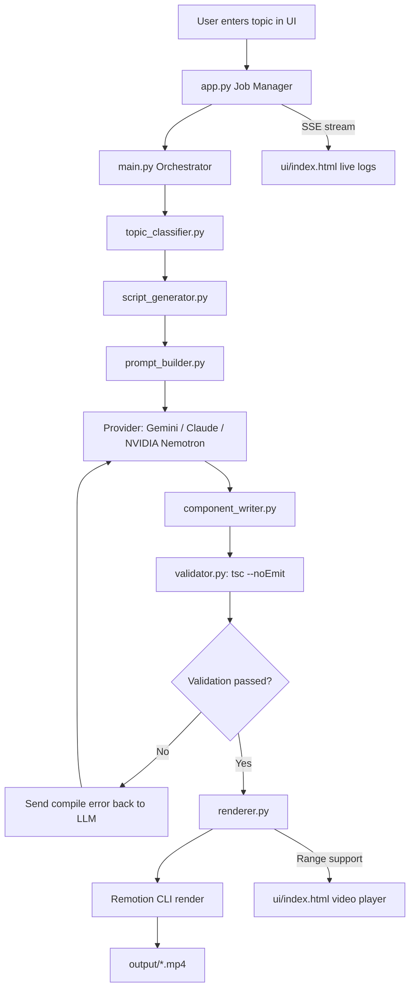
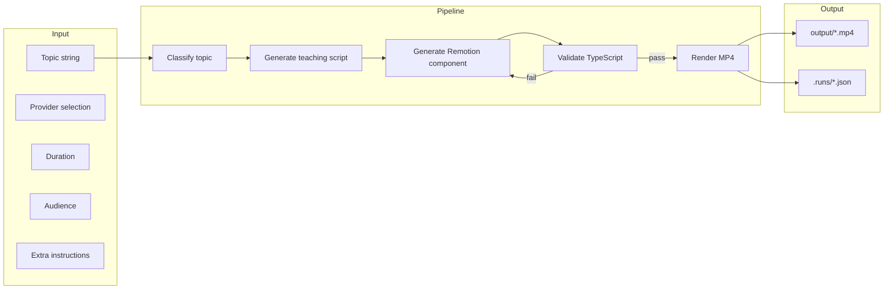
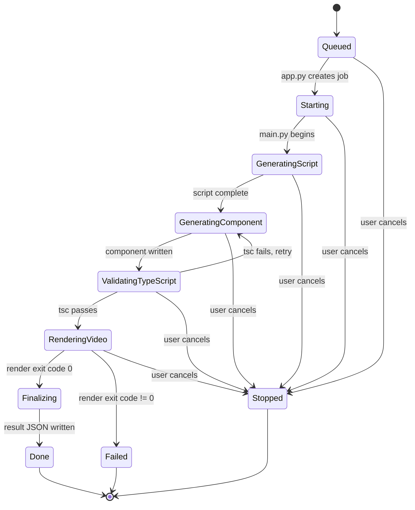
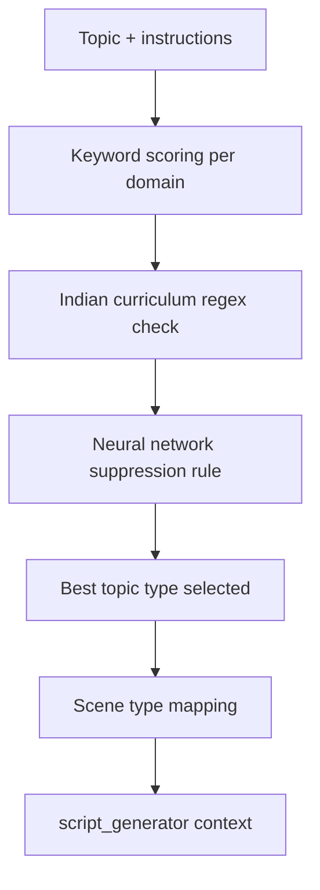
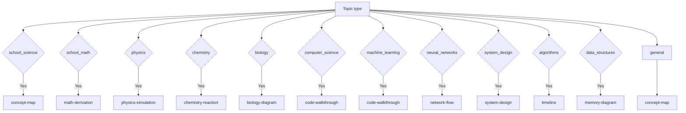

# ScriptMotion: Model-Agnostic Agentic Orchestration for Declarative Motion Graphics Compilation

ScriptMotion is a model-agnostic agentic orchestration pipeline for declarative motion graphics compilation. It turns any topic into a rendered MP4 educational video using Remotion. The pipeline classifies the topic, generates a teaching script, writes a TypeScript Remotion component, validates it with the TypeScript compiler, renders it to MP4, and streams every step live through a single-terminal web UI.

The core architectural principle is separation of concerns. The LLM is the director. It writes content and intent, not absolute pixel coordinates. The renderer owns the visual grammar: design tokens, layout, connectors, typography, motion, and safe areas are code, not prompt suggestions. Every provider implements the same typed interface, so swapping models is a configuration change, not a code change.

---

## 1. Architecture

### 1.1 System overview



### 1.2 Component responsibilities

| Component | Responsibility |
|-----------|----------------|
| app.py | Single-terminal HTTP server, job manager, SSE event stream, video file serving with Range support |
| main.py | CLI orchestrator, script-first pipeline, retry loop with compile error feedback |
| topic_classifier.py | 15-domain keyword classifier, NCERT Class 8-12 grade detection |
| script_generator.py | TeachingScript data model, VisualBeat model, script-to-context conversion |
| prompt_builder.py | Anti-AI-slop rules, cognitive load rules, motion and layout rules, QA gate |
| providers/base.py | BaseProvider ABC, ProviderRegistry, model-agnostic contract |
| providers/gemini.py | Gemini provider implementation |
| providers/claude.py | Claude provider implementation |
| providers/nvidia.py | NVIDIA Nemotron provider implementation |
| pipeline/adaptivePipeline.py | PipelineContext, topic-to-scene-type routing |
| video_spec.py | Pydantic VideoSpec schema, design tokens, scene types, animation config |
| component_writer.py | Writes generated TSX to remotion_project |
| validator.py | tsc --noEmit TypeScript validation gate |
| renderer.py | Remotion CLI invocation, concurrency fallback 2 -> 1, Windows --gl=angle |
| remotion_project/ | Remotion application: Root.tsx, EducationVideo.tsx, templates, design system |

### 1.3 Data flow



### 1.4 Job lifecycle



---

## 2. Pipeline stages

### 2.1 Stage 1: Topic classification

The classifier scores the topic string against keyword sets for 15 topic types:

- school_science
- school_math
- physics
- chemistry
- biology
- computer_science
- machine_learning
- neural_networks
- system_design
- algorithms
- data_structures
- code_walkthrough
- general

It also detects Indian curriculum patterns (NCERT, CBSE, ICSE, Class 8-12, Grade 8-12) and extracts a grade level when present. The classification determines the scene type template used for rendering.



### 2.2 Stage 2: Teaching script generation

The LLM generates a TeachingScript consisting of a core message, metaphor, learning objectives, and a sequence of VisualBeats. Each beat has:

- id
- type (hook, entities, mechanism, worked_example, mental_model, outro)
- title
- narration (word-for-word script)
- visual_intent (what the viewer sees)
- start_frame and end_frame
- elements list
- emphasis_words list

The script is derived before any visual work. This ensures the story is solid before animation timing is computed.

### 2.3 Stage 3: Remotion component generation

The script context is passed to the LLM with the system prompt from prompt_builder.py. The system prompt enforces:

- No CSS transitions or @keyframes. All motion via Remotion interpolate and spring.
- No glow halos, gradient text, or ALL-CAPS.
- No simultaneous entrances. Beats fade in and out with staggered opacity windows.
- Narration-synced timing. Each beat maps to a frame window derived from the script.
- Maximum 7 words on screen at once. Body text at least 32px for 1080p readability.
- One consistent visual metaphor per video.
- Safe area: 96px margin. Title, cards, and panels never cross it.
- SVG connectors with boundary anchors. Lines start and end at node edges, not centers.
- No decorative noise. Every element must teach.

The output is TypeScript TSX written to remotion_project/src/compositions/EducationVideo.tsx.

### 2.4 Stage 4: TypeScript validation

The validator runs npx tsc --noEmit in remotion_project. If validation fails, the compiler error is sent back to the LLM with instructions to fix only the errors. This retry loop runs up to MAX_RETRIES times (default 2). If validation still fails, the pipeline raises PipelineError.

### 2.5 Stage 5: Rendering

The renderer invokes:

npx remotion render src/index.ts EducationVideo ../output/<topic>_<timestamp>.mp4 --props props.json --concurrency <N> --image-format jpeg --jpeg-quality 90 <GL_FLAG>

On Windows, GL_FLAG is --gl=angle. On other platforms, it is --gl=swiftshader. If the requested concurrency fails, the renderer retries once with concurrency 1.

---

## 3. Configuration

### 3.1 Environment variables

Create a .env file from .env.example. You only need the key for the provider you select.

```
GEMINI_API_KEY=your_gemini_key_here
ANTHROPIC_API_KEY=your_anthropic_key_here
NVIDIA_API_KEY=nvapi-your_key_here
```

### 3.2 Provider models

| Provider | Environment variable | Model |
|----------|---------------------|-------|
| Gemini | GEMINI_API_KEY | gemini-2.5-pro |
| Claude | ANTHROPIC_API_KEY | claude-sonnet-4-6 |
| NVIDIA Nemotron | NVIDIA_API_KEY | nvidia/nemotron-3-ultra-550b-a55b |

### 3.3 Provider interface

All providers implement the BaseProvider abstract class:

- initialize(config): sets apiKey, model, temperature, maxTokens, timeout
- generate_spec(context): returns a dict or VideoSpec

The ProviderRegistry maps provider names to instances. Adding a new provider requires one new file and one registration call.

---

## 4. Topic to template routing



Scene types available:

| Scene type | Use case |
|------------|----------|
| concept-map | General concepts, relationships, entities |
| network-flow | Neural networks, data flow, signal flow |
| timeline | Chronological processes, algorithm steps |
| math-derivation | Equations, step-by-step derivation |
| chemistry-reaction | Reactants, products, conditions |
| physics-simulation | Projectile motion, wave behavior |
| biology-diagram | Cell structures, biological processes |
| code-walkthrough | Code blocks, execution traces |
| terminal | Command-line interaction |
| diff | Before/after code comparison |
| call-stack | Function call visualization |
| memory-diagram | Stack, heap, memory blocks |
| file-tree | Directory structure navigation |
| chart | Line, bar, pie, scatter, area charts |
| quiz | Multiple choice, true/false questions |
| recap | Summary, key takeaways |
| system-design | Architecture, components, connections |

---

## 5. Project layout

```
ScriptMotion/
├── main.py                     CLI orchestrator
├── app.py                      Single-terminal web server + job runner
├── ui/index.html               Dark local UI, vanilla JavaScript
├── requirements.txt            Python dependencies
├── setup.py                    Remotion scaffold + npm install
├── .env.example                API key template
├── .gitignore
├── ROADMAP.md                  Four-phase upgrade plan
├── test.py                     Quick single-topic build
├── output/                     Rendered MP4s
├── .runs/                      Per-job result JSON
├── src/
│   ├── __init__.py
│   ├── errors.py               PipelineError
│   ├── prompt_builder.py       System prompts and visual rules
│   ├── script_generator.py     TeachingScript, VisualBeat, BeatType
│   ├── topic_classifier.py     15-domain classifier + NCERT detection
│   ├── video_spec.py           Pydantic VideoSpec schema + design tokens
│   ├── validator.py            tsc --noEmit gate
│   ├── component_writer.py     Writes generated TSX
│   ├── renderer.py             Remotion CLI + concurrency fallback
│   ├── quick_fixes.py          Local TSX repair fallback
│   ├── providers/
│   │   ├── __init__.py
│   │   ├── base.py             BaseProvider ABC + ProviderRegistry
│   │   ├── interface.ts
│   │   ├── gemini.py / geminiProvider.ts
│   │   ├── claude.py / claudeProvider.ts
│   │   └── nvidia.py / nvidiaProvider.ts
│   ├── pipeline/
│   │   ├── __init__.py
│   │   └── adaptivePipeline.py PipelineContext + topic routing
│   └── curriculum/
│       ├── __init__.py
│       └── ncertScraper.py     NCERT Class 8-10 data
└── remotion_project/
    ├── package.json
    ├── tsconfig.json
    ├── remotion.config.ts
    ├── src/
    │   ├── index.ts            registerRoot
    │   ├── Root.tsx            Composition: 1920x1080, 30fps, 1800 frames
    │   ├── compositions/
    │   │   └── EducationVideo.tsx AI-generated component
    │   ├── templates/          18 scene templates
    │   ├── design-system/      Tokens + primitives
    │   └── layout/             Graph layout, collision, text measurement
```

---

## 6. Quick start

### 6.1 Install Python dependencies

```powershell
pip install -r requirements.txt
```

### 6.2 Scaffold the Remotion project

Run this once. It installs Node.js dependencies and creates the Remotion scaffold. It preserves existing source files.

```powershell
python setup.py
```

### 6.3 Configure API keys

Copy .env.example to .env and add at least one key:

```powershell
cp .env.example .env
```

Edit .env and add:

```
GEMINI_API_KEY=your_gemini_key_here
ANTHROPIC_API_KEY=your_anthropic_key_here
NVIDIA_API_KEY=nvapi-your_key_here
```

Only the key for your selected provider is required.

### 6.4 Run the studio

```powershell
python app.py
```

Open http://127.0.0.1:8000. The browser opens automatically. This single process serves the UI, runs the pipeline in a background thread, streams logs over SSE, and serves the finished MP4.

### 6.5 Build a video

1. Enter a topic, for example Backpropagation in Neural Networks.
2. Optionally add extra direction, for example Beginner audience. Use a water-flow metaphor.
3. Pick a provider: Gemini, Claude, or NVIDIA Nemotron.
4. Pick concurrency, default 2. The renderer falls back to 1 automatically on failure.
5. Click Build video or press Ctrl+Enter.
6. Watch the live log stream: classification, script, component, validation, render.
7. When done, play or seek the MP4 in the player, download it, or open the output folder.

---

## 7. CLI usage

The UI is a wrapper around main.py. Run it directly:

```powershell
python main.py "Backpropagation in Neural Networks" --provider gemini
python main.py "Rate limiting" --provider claude --duration 60 --audience beginner --instructions "Use a token bucket metaphor for beginners"
python main.py "Merge sort" --provider nvidia --concurrency 1
python main.py "Reflection of light" --provider gemini --result-file .runs/job.json
```

CLI flags:

| Flag | Default | Description |
|------|---------|-------------|
| topic | required | Video topic |
| --provider | gemini | gemini, claude, or nvidia |
| --concurrency | 2 | Remotion render workers, 1 to 8 |
| --duration | 60 | Target seconds, 30, 60, or 90 |
| --audience | beginner | beginner, intermediate, or advanced |
| --instructions | none | Extra direction for the model |
| --result-file | none | Write JSON build result to path |

Exit code 0 on success, 1 on failure.

---

## 8. Web UI API

app.py runs a ThreadingHTTPServer on 127.0.0.1:8000. It auto-finds a free port if busy.

| Endpoint | Method | Description |
|----------|--------|-------------|
| GET / | - | Serves ui/index.html |
| GET /api/health | - | Returns ok status and time |
| GET /api/history | - | Lists rendered MP4s from output |
| POST /api/build | - | Starts a build, returns job_id |
| GET /api/jobs/{id} | - | Returns job payload |
| GET /api/jobs/{id}/events | - | SSE event stream |
| POST /api/jobs/{id}/stop | - | Stops an active build |
| POST /api/open-folder | - | Opens output folder in OS explorer |
| GET /output/{name} | - | Serves MP4 with HTTP Range support |

Build request body:

```json
{
  "topic": "Backpropagation in Neural Networks",
  "provider": "gemini",
  "instructions": "Beginner audience. Use a water-flow metaphor.",
  "concurrency": 2,
  "duration": 60,
  "audience": "beginner"
}
```

---

## 9. Quality rules

Generated components must satisfy these rules:

- No CSS transitions or @keyframes. Motion via Remotion interpolate and spring only.
- No glow halos, gradient text, or ALL-CAPS.
- No simultaneous entrances. Staggered opacity windows for beats.
- Narration-synced timing derived from the teaching script.
- Maximum 7 words on screen at once.
- Body text at least 32px for 1080p readability.
- One consistent visual metaphor per video.
- Safe area: 96px margin on all sides.
- SVG connectors with boundary anchors at node edges.
- No decorative noise. Every element supports a learning goal.

---

## 10. Troubleshooting

| Problem | Fix |
|---------|-----|
| Blank or static frames on Windows | Renderer uses --gl=angle automatically |
| Render crashes with high concurrency | Use concurrency 1. Renderer retries 2 to 1 automatically |
| npx command not found | Install Node.js 18+ and re-run python setup.py |
| TypeScript errors | Pipeline retries once with compiler error. If still failing, open remotion_project and run npx remotion studio |
| Port already in use | python app.py --port 8010 |
| Build already running | Only one build runs at a time. Stop the active build first |
| No MP4 after done | Check output directory and .runs directory for result JSON |

---

## 11. Verification status

- python -m compileall -q main.py app.py src passes
- npx tsc --noEmit in remotion_project passes with zero errors
- Python syntax checks on app.py and main.py pass
- UI API smoke tests pass: health, history, root, 404, invalid build payloads, SSE lifecycle, HTTP Range 206, HEAD 200
- Renderer concurrency fallback 2 to 1 tested with mocked failure

---

## 12. Roadmap

See ROADMAP.md for the four-phase plan:

- Phase 0: Local studio, visual stability, single-terminal UI. Complete for the local harness.
- Phase 1: Typed storyboard VideoSpec, deterministic design system, model-agnostic contract. Next.
- Phase 2: Code videos, narration, TTS, captions, chapters. Planned.
- Phase 3: Automated visual QA, keyframe stills, VLM critic. Planned.
- Phase 4: Scale, cloud rendering, i18n, analytics. Planned.

---

## 13. Contributing

1. Fork the repository.
2. Create a feature branch.
3. Make changes. Run python -m compileall -q main.py app.py src and npx tsc --noEmit --prefix remotion_project.
4. Open a pull request.

---

Built with Remotion, React, TypeScript, Python, and your choice of Gemini, Claude, or NVIDIA Nemotron.
